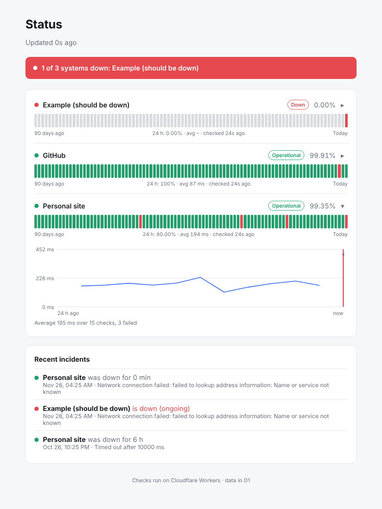

# Uptime Monitor

A small, self-hosted uptime monitor that runs entirely on Cloudflare's free tier:

- **Cron Trigger** runs HTTP checks against your sites every 5 minutes
- **D1** (SQLite) stores every check, each monitor's state and an incident log
- **Discord or Slack alerts** fire when a site goes down and when it recovers
- **React + Vite status page** shows 90-day uptime bars, 24 h response times and recent incidents
- **Admin page** at `/admin` to add, edit, pause and delete monitors, behind a password login
- **Live updates** over WebSockets through a Durable Object: open pages change as soon as checks run, no refresh needed
- Everything is **one Worker**, deployed with one command



## How it works

```
             every 5 min                      HTTP checks
 Cron Trigger ──────────► Worker.scheduled() ───────────► your sites
                               │
                               ├─ store results ────────► D1: checks, daily_stats
                               ├─ update state / incidents ► D1: monitors, incidents
                               ├─ on state change ──────► Discord / Slack webhook
                               └─ publish ──────────────► LiveStatus Durable Object
                                                            │ rebuilds the summary once,
                                                            ▼ pushes it to every open page
 Browser ──► Worker.fetch()
               ├─ /api/live ──► WebSocket to LiveStatus
               ├─ /api/*    ──► JSON API
               └─ else      ──► React status page (static assets)
```

- A monitor is marked **down** only after `FAILURE_THRESHOLD` failed checks in a row (default 2), so one blip doesn't page you. One alert goes out when it goes down and one when it recovers.
- A check fails on timeout (default 10 s), network error, or a status outside the expected range (default 200–399). Latency is measured to the response headers.
- Check rows older than `RETENTION_DAYS` (default 90) are deleted once a day.
- **Staying in the free tier:** each check also updates a per-day row in `daily_stats`, so building the summary reads about 90 rows per monitor for the uptime bars instead of every check in the window. The `LiveStatus` Durable Object builds the summary once per cron run and serves it to every viewer, so D1 reads don't grow with traffic. Its WebSockets use the Hibernation API, so idle connections cost nothing. If the socket drops, the page polls `/api/summary` every 30 s and keeps reconnecting.

## Project layout

```
worker/       Cloudflare Worker (TypeScript)
  index.ts      fetch + scheduled handlers
  checks.ts     HTTP checks, state machine, incidents
  alerts.ts     Discord / Slack webhook
  api.ts        public JSON API + admin API
  auth.ts       admin login: password check, signed session cookie, lockout
  summary.ts    builds the status summary from D1
  live.ts       LiveStatus Durable Object: cached summary + WebSockets
src/          React status page (Vite)
  admin/        admin page at /admin (loaded only there)
shared/       Types shared by the Worker and the frontend
migrations/   D1 schema
seed.sql      Starter monitors (edit me)
wrangler.jsonc Worker config: cron schedule, D1 binding, settings
```

## Run it locally

Requires Node.js 18+ and [pnpm](https://pnpm.io/installation).

```bash
pnpm install
pnpm db:migrate:local      # create the tables in a local D1 database
pnpm db:seed:local         # add the monitors from seed.sql (edit it first)
pnpm dev                   # status page + API at http://localhost:5173
```

The cron doesn't fire on its own in dev. Trigger a run manually:

```bash
curl "http://localhost:5173/cdn-cgi/handler/scheduled"
```

To use the admin page and test alerts locally, create a `.dev.vars` file (git-ignored):

```
ADMIN_TOKEN=some-local-token
ALERT_WEBHOOK_URL=https://discord.com/api/webhooks/...
```

## Deploy to Cloudflare

```bash
pnpm wrangler login                       # once, opens the browser
pnpm wrangler d1 create uptime            # copy the database_id it prints into wrangler.jsonc
pnpm db:migrate:remote
pnpm db:seed:remote
pnpm wrangler secret put ALERT_WEBHOOK_URL   # paste your Discord or Slack webhook URL
pnpm wrangler secret put ADMIN_TOKEN         # your admin password: a long random string
pnpm run deploy
```

It goes live at `https://uptime-monitor.<your-subdomain>.workers.dev`. To use your own domain, add a custom domain to the Worker in the Cloudflare dashboard.

Getting a webhook URL:
- **Discord:** Server Settings → Integrations → Webhooks → New Webhook → Copy URL
- **Slack:** create an app with Incoming Webhooks enabled and copy the webhook URL

## Configuration

In `wrangler.jsonc`:

| Setting | Default | What it does |
| --- | --- | --- |
| `triggers.crons` | `*/5 * * * *` | How often checks run |
| `vars.SITE_TITLE` | `Status` | Title on the status page |
| `vars.FAILURE_THRESHOLD` | `2` | Failed checks in a row before "down" + alert |
| `vars.RETENTION_DAYS` | `90` | How long check history is kept (and the bar chart window) |

Secrets (`pnpm wrangler secret put <NAME>`):

| Secret | Required | What it does |
| --- | --- | --- |
| `ALERT_WEBHOOK_URL` | No | Discord or Slack incoming webhook; no alerts without it |
| `ADMIN_TOKEN` | No | Password for the admin page and token for the admin API; both are disabled without it. Changing it logs out every session. |

## Public API

Read-only. Monitor URLs aren't exposed:

| Method | Path | Returns |
| --- | --- | --- |
| GET | `/api/summary` | All monitors with status, uptime, daily buckets, recent incidents |
| GET (WebSocket) | `/api/live` | Sends the summary on connect and again after every check run. Send `ping` to get `pong`. |
| GET | `/api/monitors/:id/latency?hours=24` | Individual checks for the latency chart (max 168 h) |

## Admin page

Go to `/admin` and log in with your `ADMIN_TOKEN`. From there you can add monitors, edit them (name, URL, method, timeout, expected status range), pause or resume them, delete them, and run all checks right away. Changes show up on open status pages immediately.

- Logging in sets a session cookie that lasts 7 days: `HttpOnly`, `SameSite=Strict`, `Secure` over HTTPS, and only sent to `/api/admin`. It's signed with a key derived from `ADMIN_TOKEN`, so no sessions are stored and changing the token logs everyone out.
- Writes made with the cookie are refused unless they come from the site's own origin.
- After 10 wrong passwords from one IP, logins from that IP are refused for 15 minutes.

## Admin API

For scripts, send `Authorization: Bearer <ADMIN_TOKEN>` (the admin page's session cookie also works):

| Method | Path | Body |
| --- | --- | --- |
| GET | `/api/admin/monitors` | List monitors including URLs |
| POST | `/api/admin/monitors` | `{ "name": "...", "url": "https://...", "method": "GET", "timeout_ms": 10000, "expected_status_min": 200, "expected_status_max": 399 }` |
| PATCH | `/api/admin/monitors/:id` | Any of `name`, `url`, `method`, `timeout_ms`, `expected_status_min`, `expected_status_max`, `paused` |
| DELETE | `/api/admin/monitors/:id` | Deletes the monitor and its history |
| POST | `/api/admin/run` | Runs all checks now and returns the results |
| POST | `/api/admin/login` | `{ "password": "..." }`: sets the session cookie |
| POST | `/api/admin/logout` | Clears the session cookie |
| GET | `/api/admin/session` | 200 when logged in, 401 when not |

Example:

```bash
curl -X POST https://uptime-monitor.<you>.workers.dev/api/admin/monitors \
  -H "Authorization: Bearer $ADMIN_TOKEN" \
  -H "Content-Type: application/json" \
  -d '{"name": "My site", "url": "https://example.com"}'
```

## Ideas for next steps

- **Multi-region checks:** run checkers in Durable Objects with location hints (e.g. Western Europe, US East, Asia) and only mark a site down when several regions agree. That avoids false alarms from one region's network.
- **Keyword checks** (the page must contain a string) and TCP checks via the Workers `connect()` API.
